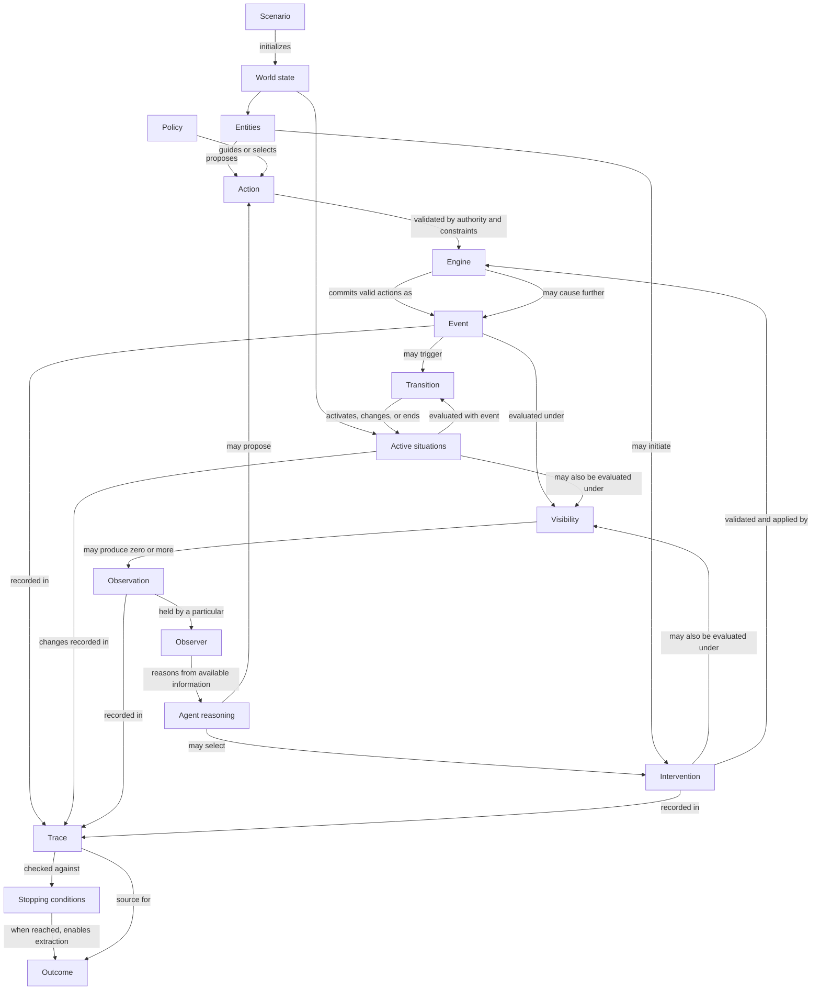

# A History-Derived Multi-Agent Ecosystem Model

## Executive summary

### What is the model?

The framework is a parameterizable, partially observable synthetic ecosystem for comparing policies under identical controlled conditions. It is not a digital twin and does not claim to reproduce or predict real-world behavior.



### Essential concepts

| Concept | Definition | One line of provenance |
|---|---|---|
| Entity | A configurable actor or institutional participant. | Instantiated from a profile in a scenario. |
| Scenario | The initial entities, situations, constraints, policy, and horizon. | Creates the initial world state \(X_0\). |
| Event | An immutable, timestamped world change or action. | Produced by an authorized action and committed to history. |
| Situation | An active interpretation or phase of the ecosystem. | Activated or replaced by a transition rule and source event. |
| Transition | A rule that changes situations. | `current situation + trigger + conditions -> new situation`. |
| Observation | Awareness of a source artefact held by one actor. | Derived from an artefact plus actor-specific visibility rules. |
| Action | A candidate behavior considered by an actor or policy. | Evaluated locally using the actor's available observations. |
| Intervention | A deliberate action intended to change later evolution. | Selected from observations, assessment, and policy. |
| World state | The explicit snapshot of entities, situations, relationships, observations, restrictions, and history. | Reconstructed from the initial state and immutable trace. |
| Outcome | A fact extracted after termination. | Derived from the final world state and complete trace. |

### Event-centered execution

```text
Scenario -> Initial world state -> Actor-specific reasoning -> Candidate actions
-> Validated events -> {situation transitions; zero or more observations; trace record}
-> Actor-specific reasoning -> {new actions; interventions} -> further events
-> stopping condition -> outcomes derived from the trace
```

The branches from an event are related but not a single serial pipeline. One event may change a situation, generate observations for multiple actors, do both, or generate no observations. Each actor reasons only from information available to that actor. The trace records the execution as it unfolds; outcomes are derived from that history when the run stops.

### Separation of responsibilities

| Layer of control | What it defines |
|---|---|
| Domain vocabulary | Which entities, events, situations, observations, interventions, and outcomes may exist. |
| Scenario | The initial conditions and stopping horizon. |
| Authority rules | Which actors may generate which events or interventions. |
| Transition rules | Which situations may evolve from which triggers. |
| Visibility rules | Which actors may observe which artefacts and under what conditions. |
| Policy | How actors or systems choose actions and interventions. |
| Execution semantics | When events are validated, committed, consolidated, and terminated. |
| Trace extraction | Which outcome facts are derived from the recorded history. |

### Scientific contribution

The model's central principle is **history derivation**: every event, situation, observation, intervention, and outcome must be traceable to an earlier state, an actor, and an explicit rule or source. This enables:

- reproducible synthetic runs;
- controlled policy comparison;
- explicit partial observability;
- auditable intervention decisions;
- separation of descriptive outcomes from value judgments.

It does not provide probabilities, digital-twin realism, psychological validity, or empirical causal claims.

## Abstract

This document generalizes the Child Online Protection v0.9 environment into a reusable methodology for studying the effects of interventions in a partially observable multi-agent ecosystem. The framework is not a digital twin and makes no claim to realism or empirical predictive validity. It is an explicitly constrained, auditable, and reproducible synthetic environment in which a scenario initializes actor configurations, actors and policies generate actions and interventions, committed events change world situations, visibility rules determine what each actor knows, and the immutable execution history determines the outcomes.

The central methodological principle is **history derivation**: an event, situation, observation, intervention, or outcome has explanatory value only if it can be derived from an earlier state and an explicit rule or source. This makes the system suitable for controlled policy comparison, because differences in traces can be attributed to declared configurations and rules rather than hidden implementation assumptions.

## 1. Research purpose and scope

The reusable object of study is an ecosystem composed of heterogeneous actors that interact under different knowledge conditions and policies. Examples include child online protection and the impact of generative-AI use on competence acquisition in higher education. In both cases, the environment may be used to ask:

- How do different actor configurations respond to the same scenario?
- How do event sequences create, replace, or deactivate situations?
- How does partial visibility shape decisions and coordination?
- Which interventions change subsequent situations or outcomes?
- How do policy alternatives compare under identical initialization and execution rules?
- Which evidence is available to each stakeholder, and what is only private or internal?

The framework deliberately separates four kinds of claims:

1. **Possibility**: a vocabulary item or transition is legally allowed.
2. **Instantiation**: a scenario or event creates an actual actor or situation.
3. **Execution**: an engine commits an action or applies a rule at a timestep.
4. **Evaluation**: a researcher compares final outcomes or traces across runs.

The model defines possibility and instantiation without supplying probabilities, risk scores, causal certainty, utilities, rewards, or a realism model.

## 2. Core concepts

The following concepts form a reusable model. Names may be customized, but the relationships should remain explicit.

| Concept | Reusable meaning | Child-protection example |
|---|---|---|
| Entity | A typed participant or configurable object | Child, threat actor, teacher, platform |
| Configuration | Textual or structured attributes describing an entity | “seeks help after escalation” |
| Scenario | Initial entities, situations, constraints, and horizon | Grooming opportunity |
| Event | An immutable, timestamped change or action in the shared world | Friend request accepted |
| Situation | An active interpretation or phase of the ecosystem | Trust building or ambiguous signals |
| Transition | A rule activating or replacing situations | Trust building plus secrecy request becomes secrecy request |
| Observation | Awareness of artefacts held by a particular actor | A teacher observes behavioral change |
| Visibility rule | A rule governing actor access to an artefact | Direct, local, restricted, private, or conditional |
| Action | A policy- or actor-dependent candidate behavior | Request information or issue a warning |
| Intervention | An action intended to alter later evolution | Parent notification or temporary restriction |
| World state | The explicit snapshot of entities and histories at a timestep | Active situations, restrictions, observations |
| Trace | The complete, ordered execution record | Events, situations, observations, interventions, outcomes |
| Outcome | A description extracted after termination | Contact terminated or educational intervention |
| Policy | The configuration controlling action and intervention selection | Privacy-first versus base platform policy |

“Ontology” is used in the project for a **controlled domain vocabulary plus constraints**. It does not imply OWL, RDF, or a universal description of reality. A better general term is **domain model** or **controlled evolution vocabulary**, while “domain ontology” remains usable if the project explicitly defines it as a local specification rather than a formal semantic ontology.

## 3. Formal abstraction

Let:

- $A$ be the finite set of instantiated actor entities.
- $C$ be the set of entity configurations.
- $\mathcal{E}$ be the permitted event vocabulary.
- $\mathcal{S}$ be the permitted situation vocabulary.
- $\mathcal{O}$ be the permitted observation vocabulary.
- $\mathcal{I}$ be the permitted intervention vocabulary.
- $\mathcal{R}$ be the permitted relationships and interactions.
- $X_t$ be the world state at timestep $t$.
- $\mathrm{H}_t=(H^e_t,H^s_t,H^o_t,H^i_t)$ be the immutable event, situation, observation, and intervention histories.
- $V_t(a,x)$ decide whether actor $a$ may observe artefact $x$ in state $X_t$.
- $P$ be a policy configuration.
- $B$ be scenario constraints and an execution horizon.

A run can be represented by:

$$
\mathrm{Trace} =
(S_0,P,B,\mathrm{Seed},X_0,X_1,\ldots,X_n)
$$

where $S_0$ is the scenario and every transition satisfies

$$
X_{t+1} =
F(X_t,A_t,E_t,O_t,I_t,T_t),
$$

with:

- $A_t$: candidate actions selected by actors or policy;
- $E_t$: validated and committed events;
- $O_t$: visibility-generated observations;
- $I_t$: applied interventions;
- $T_t$: situation transitions;
- $F$: the explicitly declared execution semantics.

The model is deliberately history-aware. Reconstructability requires that:

$$
X_t =
\mathrm{Reconstruct}(X_0,P,B,\mathrm{Seed},E_{0:t},O_{0:t},I_{0:t},T_{0:t}).
$$

No relevant state may exist outside the represented data.

## 4. The reusable engine

The project may be organized around **spaces** or concept families rather than rigid layers. The following is a useful view:

```text
Entity Space       -- what may exist
Scenario Space     -- what is assumed at initialization
Event Space        -- what may change the world
Situation Space    -- what may become true or active
Visibility Space   -- who may know what
Observation Space  -- what actors become aware of
Action/Policy Space-- what actors may choose
Intervention Space -- what is deliberately applied
World-State Space  -- what is true and active now
Trace/Outcome Space-- what happened and was derived
```

These are not nested software layers. They are linked specifications and runtime roles. A layer metaphor may obscure cross-cutting authority, visibility, and traceability. A **vocabulary-plus-rules model** is more accurate.

### 4.1 Entity space

An entity is an instantiated, typed participant with a configurable profile. In the source project, entity types include children, threat actors, parents or caregiving units, teachers, psychologists, platforms, and protection systems. Generalization replaces these names with role types appropriate to the domain.

An entity profile should contain:

- identity and type;
- stable and mutable attributes;
- available capabilities;
- permitted event types;
- observation channels;
- action and intervention policies;
- resource constraints;
- relevant relationship to other entities.

Profiles should prefer observable or textual descriptions over synthetic ordinal magnitudes. For example, “recovers quickly after a negative experience” is preferable to “resilience: 7/10” unless numeric quantities are native to the domain and empirically justified.

An entity does not need to be a person. It can be an institution, platform, model, department, tool, or automated system.

### 4.2 Scenario space

A scenario is a declarative initial condition, not a script. It specifies:

- participating entities and configurations;
- initial situations;
- explicit constraints;
- relationships and resource conditions;
- the execution horizon;
- stopping rules;
- policy configurations to hold constant or vary.

Scenarios may deliberately leave later actions underdetermined. Synthetic actions not declared by the scenario must be identified as controlled assumptions, not facts inferred from profiles.

### 4.3 Event space

An event is the smallest authoritative unit of world evolution. It is typed, timestamped, attributed to an actor, directed to targets, and associated with context.

Each event should include:

- unique identifier;
- permitted event type;
- initiating actor;
- target or targets;
- communication channel or medium;
- discrete timestamp;
- optional context;
- optional source or rationale.

Events are immutable. They may not be removed or rewritten after commitment. New interpretations belong in observations or derived situations, not as mutation of the event.

An event does not imply that every actor observed it, inferred it, or agrees with its interpretation.

### 4.4 Situation space

A situation is an active semantic state of the ecosystem. Situations may concern relationships, risk, manipulation, coordination, organizational readiness, learning, or other domains.

A situation instance should include:

- unique identifier;
- situation type;
- activation time;
- originating event or initialization marker;
- active status;
- optional participating entities or scope.

Multiple situations may coexist. A situation does not have to replace all other situations. Situations may persist, be superseded, be deactivated, or become terminal.

A situation is not a hidden scalar and should not be assigned a synthetic probability or risk magnitude.

### 4.5 Transition space

Transition rules are rewrites of situation state:

$$
\text{Current situation} +
\text{Trigger or intervention} +
\text{Optional condition}
\rightarrow
\text{Next situation}.
$$

Transitions are:

- domain-specific;
- explicitly enumerable;
- independent of scenario initialization;
- traceable to events or observations;
- deterministic when evaluated.

The engine must separate **which transitions are legal** from **when and how a policy evaluates or applies them**. This avoids mixing vocabulary, execution, and intervention selection.

### 4.6 Action and intervention spaces

Actions are candidate behaviors generated by actors. They become events only after passing authority and constraint validation.

Interventions are selected actions or process changes intended to influence evolution. An intervention record should explain:

- identifier and type;
- initiator and target;
- timestamp;
- motivating observation or assessment;
- context;
- status or duration;
- any visibility or state effects.

The domain ontology should define intervention options, while policy configuration decides how and why an option is selected. The outcome ontology must remain independent: it describes what happened and must not encode whether the result is good, bad, successful, or unsuccessful.

### 4.7 Information and observation space

Partial observability is a first-class property. For each eligible source artefact, the process is:

1. A world artefact exists: event, situation, observation, or intervention.
2. Visibility rules identify candidate observers.
3. Mandatory, conditional, and forbidden visibility categories are resolved.
4. Zero or more observations are created, one for each eligible observer.
5. The observation records its source and visibility basis.

Observations belong to actors. Other actors may not automatically inherit them; propagation requires an explicit reporting, escalation, referral, or sharing event.

An event can independently affect situation state, produce observations for different actors, and be recorded in the trace. None of these effects guarantees the others: an event can produce no observation, and its situation effect does not imply that an actor observed it.

A visibility rule may be:

- **public**: eligible to every participating actor;
- **local**: eligible to directly participating actors;
- **restricted**: eligible after a declared escalation or sharing condition;
- **private**: eligible only to the source actor or process;
- **conditional**: eligible only if an explicit enabling condition is active.

This makes coordination and disagreement between actors part of the model rather than an implementation accident.

### 4.8 World-state space

The world state is the explicit snapshot used for execution and reconstruction. It should contain only declared, auditable components, such as:

- active entities;
- active situations;
- relationships;
- interactions;
- restrictions;
- observations possessed at that state;
- active interventions;
- visibility state;
- cumulative histories;
- scenario, policy, seed, and engine metadata.

Two executions are reproducible when, given the same scenario, entities, policy, ontology, seed, and execution rules, they generate the same trace. If random selection exists, it must be seeded and recorded. Hidden stochasticity or hidden state invalidates reproducibility.

### 4.9 Trace and outcome space

A trace is the primary scientific artifact. It should contain at least:

- simulation and scenario identifiers;
- seed and engine version;
- complete initial-agent configurations;
- scenario constraints and policy identifier;
- ordered events;
- situation activation and replacement history;
- observations and visibility bases;
- interventions;
- final outcomes;
- stopping reason and simulation horizon.

An outcome is an extraction produced after termination. It should be a report of observable trace facts, not a judgment. Researchers may define their own evaluation functions over traces, but such functions should be outside the runtime ontology and fully reported.

## 5. Execution semantics

The reusable execution cycle is event-centered rather than a fixed linear pipeline:

```text
1. Load the scenario, instantiate entities, and activate initial situations.
2. Evaluate each actor using only that actor's available information.
3. Generate and validate candidate actions under the policy, authority, and scenario constraints.
4. Commit valid actions as events and append them to the trace.
5. From each committed event, independently evaluate situation transitions and resolve visibility; record each resulting change or observation.
6. Let each actor reason from its own observations and other information explicitly available to it; actors may propose new actions or interventions.
7. Validate and apply interventions; record them and any resulting events or state effects.
8. Consolidate the world state, check stopping conditions, and repeat from actor evaluation if the run continues.
9. Derive outcomes from the final state and complete trace after termination.
```

An event may yield a situation change, multiple actor-specific observations, both, or neither. The cycle need not be strictly synchronous and may support parallel agents or actor-specific scheduling. Any scheduling rule must be explicit and reproducible.

### Authority

Authority is part of validity, not merely an actor description. A system must define which actor types may emit which events or interventions. An unauthorized event is invalid and must not be committed. This differs from whether an actor **knows** an event or **chooses** to perform it.

### Constraints

An event may be rejected when it violates scenario constraints, current relationships, visibility restrictions, or termination rules. The rejected candidate and the reason for rejection should be recorded if needed for auditing. Silent filtering is not acceptable.

### Termination

A scenario may terminate by horizon, terminal situation, explicit policy rule, or custom stopping condition. All stopping rules must be declared before execution. Terminal activation does not necessarily imply termination unless execution semantics say so.

### Outcomes

Outcome derivation must use only declared extraction rules. It may inspect the final state and complete trace. It must not use hidden agent reasoning or undocumented engine behavior.

## 6. Information derivation and provenance

Every derived artefact should have a source. A practical provenance rule is:

$$
\text{Derived artefact}
\leftarrow
\text{source artefact}
+
\text{applicable rule}
+
\text{timestamp}
+
\text{visibility or authority basis}.
$$

Examples include:

- situation from an event and a transition rule;
- observation from an event or situation and a visibility rule;
- intervention from observations or assessments and a policy rule;
- outcome from the trace and an outcome extraction rule.

This provenance is what turns a trace into an audit trail rather than a narrative.

## 7. Subjective magnitudes and textual attributes

The project avoids fabricated quantification of subjective concepts. No observer should infer that an attribute means “high,” “medium,” or “low” solely because that label is convenient. Textual descriptions should preserve the documented evidence:

- “has few or no close friends”;
- “seeks help after escalation”;
- “occasionally talks with unknown users.”

If a numeric measure is added, it must be:

- native to a measurement instrument;
- accompanied by units and scale;
- tied to an empirical or formal source;
- converted only through declared rules.

The system may compare profiles through structured attribute values, but it must not manufacture psychological realism or precision.

## 8. Methodology for a paper

A paper using this framework should report the following methodology:

### 8.1 Define the research question

State the ecosystem, intervention alternatives, expected traceable effects, and variables held constant.

### 8.2 Declare the reusable model

Specify entities, event types, situation types, observation types, intervention types, transitions, authority rules, and visibility rules.

### 8.3 Define configurations

Separate:

- stable domain profiles;
- scenario initialization;
- policy alternatives;
- random seed or deterministic scheduling;
- stopping and horizon rules.

### 8.4 Initialize comparable runs

Assign a scenario identifier and instantiate entities consistently across policy alternatives. Record all differences between runs. A counterfactual comparison should change only the policy or declared intervention under study.

### 8.5 Execute and capture

Run the engine in a way that produces complete traces and world-state snapshots. Do not permit hidden state or unexplained concept creation.

### 8.6 Derive outcomes

Specify extraction rules before interpreting results. Outcomes describe trace facts. Additional quality or welfare judgments require a separate, explicitly declared evaluative layer.

### 8.7 Compare and audit

Compare policy traces, not imagined real-world effects. For each observed difference, identify the triggering event, visibility transition, intervention, or situation transition responsible.

### 8.8 State limitations

Explain that the environment:

- does not estimate real-world prevalence;
- does not validate behavioral realism;
- is not a causal model of people or institutions;
- does not claim external or predictive validity;
- supports reproducible policy and mechanism comparisons within controlled assumptions.

## 9. Customization example: generative AI and competence acquisition

The model can be reused by defining a new set of actors and artefacts.

### Entities

Possible entity types include:

- student;
- instructor;
- peer or group;
- learning-management system;
- generative-AI assistant;
- assessment service;
- institution or study-support service.

Profiles may contain textual attributes such as prior subject familiarity, help-seeking behavior, critical-evaluation practices, and observed access to study resources.

### Events

Example event types include:

- task presented;
- AI tool used;
- explanation requested;
- generated answer accepted;
- answer modified by student;
- source checked;
- student asked instructor for help;
- assessment submitted;
- feedback delivered;
- learning intervention applied.

The event ontology should distinguish using AI, revising AI-generated content, and verifying content. It should not collapse them into “AI use.”

### Situations

Example situation types include:

- independent problem solving;
- AI-assisted practice;
- answer acceptance;
- source verification;
- help-seeking coordination;
- over-reliance concern;
- developing proficiency;
- assessment uncertainty.

Multiple situations may coexist: for example, an activity may involve AI assistance and independent verification.

### Observations

The student may observe an answer and feedback. The AI system may observe prompts and revisions if configured. The instructor may observe submissions and declared AI-use reports, but may not observe private conversations without a configured information channel.

### Interventions

Possible interventions include:

- prompt-writing scaffold;
- source-verification task;
- explanation requirement;
- reduced AI assistance;
- instructor feedback;
- peer review;
- AI-use disclosure;
- reassessment.

### Outcomes

Trace outcomes might include:

- task completed;
- source verification performed;
- independent revision performed;
- help sought;
- intervention delivered;
- instructor evidence received;
- competence situation reached.

The framework should not infer that an outcome demonstrates improved real-world competence unless the domain adds a separately validated measure and assumptions.

### Policy comparison

Example policy alternatives include:

- unrestricted AI access;
- AI access with source-check requirements;
- staged scaffolding and eventual tool removal;
- instructor-mediated AI use;
- assessment without AI.

The same scenario and seed may drive all policy alternatives. Differences in trace, including help-seeking, revision, and observed situations, can then be reported as controlled environment effects.

## 10. Implementation implications

An implementation can be a declarative file system or a typed engine, but it should expose:

- one controlled vocabulary per concept;
- machine-readable scenarios;
- machine-readable transition rules;
- machine-readable visibility rules;
- authority checks before event commitment;
- deterministic execution under a recorded seed;
- immutable histories;
- world-state snapshots;
- trace serialization;
- outcome extraction functions;
- engine and schema versions.

The data model should preserve the distinction between:

```text
event
observation
relationship
interaction
situation
intervention
outcome
```

An observation is not an event. A situation is not an outcome. An intervention is not a policy. A profile is not a scenario.

## 11. Consolidation guidance

The repository contains several overlapping specifications, so version 1.0 of the abstraction should consolidate rather than add a new parallel design:

1. **Choose one transition source of truth.** The two state-transition documents overlap but differ in detail and should be reconciled into one document.
2. **Choose one execution loop.** Preserve the step structure in ExecutionSemantics while separating candidate action generation from event commitment.
3. **Standardize identifiers and references.** Every situation state should reference a transition rule or initialization source, and every observation should reference a source artefact and visibility basis.
4. **Separate policy from ontology.** Domain vocabularies should not decide interventions or optimization strategy.
5. **Separate outcome extraction from policy evaluation.** Outcome vocabulary should describe facts; external metrics may compare or score traces.
6. **Make “world state” fully complete.** Actor-local knowledge can exist as derived observations or local views rather than implicit hidden state.
7. **Consolidate agent-specific authority with events.** EventAuthorityOntology already supplies this role and should remain a machine-readable constraint.
8. **Retain synthetic disclaimers.** README and entrega demonstrate the core purpose: controlled policy exploration, not digital-twin fidelity.

## 12. Sources reviewed

This abstraction was derived from all repository Markdown sources, notably:

- project purpose and demonstration materials: `README.md`, `entrega.md`;
- general simulation model: `knowledge_base/simulation.md`;
- reusable knowledge structure: `knowledge_base/structure.md`;
- entity profiles: `knowledge_base/agent/`;
- controlled vocabularies: `knowledge_base/ontology/`;
- transition and visibility rules: `knowledge_base/rules/` and `knowledge_base/specification/`;
- executable structures and semantics: `knowledge_base/specification/`;
- initialization examples: `knowledge_base/scenario/`;
- original customization ideas: `ideas.md`.
