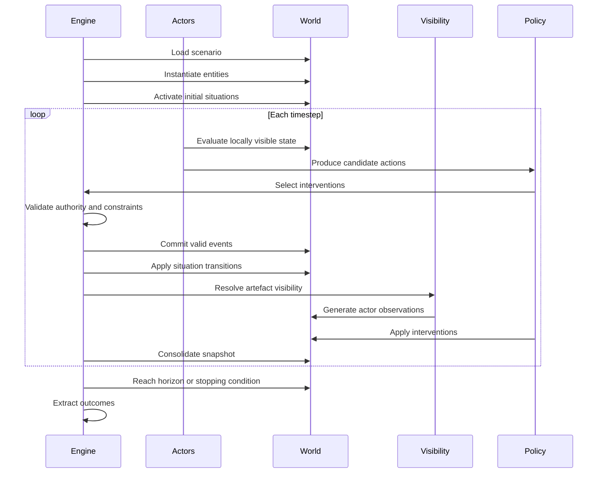

# Instantiation Proposal: Child Online Protection

## Purpose

This document explains how the abstract [History-Derived Multi-Agent Ecosystem Model](/workspaces/TUD_LORE_ChildProtection/abstraction/abstraction.md) becomes a concrete project for child online protection.

It is an instantiation plan, not a claim that the synthetic environment predicts real children or real harms.

```text
Abstract model                    Child online protection implementation
Entity                  -->      Child, threat actor, caregiver, teacher,
                                  psychologist, platform, protection system
Scenario                -->      A concrete initial ecosystem and horizon
Event                   -->      A contact, disclosure, report, warning, or restriction
Situation               -->      Friendship, dependency, coercion, or protection coordination
Visibility              -->      Who may observe an event or situation
Observation             -->      An actor-specific awareness record
Action / policy         -->      Agent behavior and platform protection policy
Intervention            -->      Warning, support, notification, or restriction
World state             -->      Explicit state and immutable histories at one timestep
Outcome                 -->      Trace-derived description of the completed run
```

## 1. Starting decisions

Before implementation, make the following decisions explicit.

| Decision | Concrete choice |
|---|---|
| Research objective | Compare protection policies under the same synthetic initial conditions. |
| Unit of analysis | One complete simulation run and its audit trace. |
| Domains represented | Online interaction, information disclosure, support, intervention, and protection coordination. |
| Actors | Child, threat actor, caregiver unit, teacher, psychologist, platform, and protection system. |
| Time | Ordered timesteps with no required correspondence to real-world minutes or days. |
| Simulation mode | Deterministic and seeded. The same inputs must produce the same trace. |
| Allowed values | Controlled vocabularies rather than inferred probabilities or ratings. |
| Outcomes | Descriptive trace facts, not welfare or success judgments. |

The project should answer questions such as:

- What happens when a platform uses warnings versus restrictions?
- Which actors receive which signals, and why?
- How does an information-sharing event change later coordination?
- Which trace events explain a final outcome?
- Does an intervention alter subsequent situations under the controlled scenario?

## 2. Project structure

Keep declarations separate from implementation.

```text
child-protection/
  domain/
    entities.yaml
    events.yaml
    situations.yaml
    transitions.yaml
    observations.yaml
    interventions.yaml
    outcomes.yaml
  rules/
    authority.yaml
    visibility.yaml
    stopping.yaml
  scenarios/
    grooming_opportunity.yaml
    cyberbullying_spillover.yaml
  policies/
    platform_warning.yaml
    education_first.yaml
    escalation_first.yaml
  engine/
    initialize/
    evaluate/
    validate/
    commit/
    transition/
    observe/
    intervene/
    consolidate/
  traces/
    SIM-001/
  tests/
```

The names may change, but the separation matters:

- domain files define possibilities;
- scenarios define initial conditions;
- rules define validity and visibility;
- policies define choices;
- the engine defines execution;
- traces are generated evidence.

## 3. Define entities

An entity is instantiated from a textual or structured profile.

### Core entity types

| Entity | Primary role |
|---|---|
| Child | Participates in interactions and may disclose information or seek help. |
| Threat actor | Initiates contact and manipulative or harmful interactions. |
| Caregiver unit | Provides supervision and may receive notifications or apply limits. |
| Teacher | Observes school-related behavior and may support or escalate. |
| Psychologist | Provides professional assessment and support. |
| Platform | Hosts communication and may warn, restrict, or moderate. |
| Protection system | Aggregates permitted signals and selects interventions. |

### Entity profile example

```yaml
Entity:
  id: child-001
  type: child
  profile:
    age: 14
    stranger_interaction:
      "occasional interactions with unknown users"
    help_seeking:
      "seeks help after escalation"
    supervision:
      "limited caregiver knowledge of online activities"
```

Profiles should use text or domain-native categories. They should not invent scores for loneliness, vulnerability, or risk unless a validated source and scale are specified.

### Entity authority

Authority is declared independently of visibility.

| Entity | May emit examples |
|---|---|
| Child | accepted request, continued conversation, disclosure, report, help-seeking |
| Threat actor | request, trust-building message, secrecy request, pressure |
| Caregiver | guidance, notification receipt, contact limitation |
| Teacher | school guidance, report, support |
| Psychologist | assessment, support, intervention recommendation |
| Platform | warning, moderation, restriction, platform signal |
| Protection system | assessment, notification, escalation, restriction recommendation |

Any event not in an entity's authority table is invalid.

## 4. Define event types

Start with the smallest controlled vocabulary needed for the scenario.

### Friendship and interaction

- Friend request sent
- Friend request accepted
- Conversation started
- Conversation continued
- Contact blocked
- Contact restricted

### Information

- Personal information requested
- Personal information shared
- Name or age shared
- Location shared
- Photo shared

### Protective signals

- Child report submitted
- Behavior change observed
- Increased online activity observed
- Disclosure observed
- Help-seeking behavior observed

### Intervention and support

- Privacy reminder shown
- Educational guidance delivered
- Teacher support provided
- Caregiver notified
- Contact limitation applied

An event instance has the following shape:

```yaml
Event:
  id: E-001
  type: Personal information shared
  actor: child-001
  targets: [threat-001]
  channel: direct_message
  timestamp: T-08
  context:
    information_type: name
```

Events are immutable after commitment.

## 5. Define situations

Situations should represent broad phases, not numeric or psychological truth.

### Recommended situation families

| Family | Example situations |
|---|---|
| Relationship | No relationship, new friendship, established friendship |
| Interaction | Trust building, dependency formation, secrecy request |
| Harm progression | Emotional pressure, coercion |
| Protection | No relevant signals, ambiguous signals, conflicting signals |
| Coordination | Coordinated protection effort |
| Terminal | Contact terminated, coercion, coordinated protection effort |

A situation instance records how and when it exists:

```yaml
Situation:
  id: SS-004
  type: Trust building
  active: true
  activation_time: T-06
  originating_event: E-006
```

Multiple situations may coexist. For example, a relationship can remain active while protection actors coordinate.

## 6. Define transitions

Each transition should follow one of these forms:

```text
Current situation + event -> next situation
Current situation + observation -> next situation
Current situation + intervention -> next situation
Current situation + event + explicit condition -> next situation
```

Example transition set:

| Current situation | Trigger | Conditions | Next situation |
|---|---|---|---|
| No relationship | Friend request accepted | — | New friendship |
| New friendship | Conversation continued | Repeated conversation | Established friendship |
| Established friendship | Trust-building conversation | — | Trust building |
| Trust building | Secrecy requested | — | Secrecy request |
| Trust building | Personal information shared | — | Dependency formation |
| Dependency formation | Emotional pressure applied | — | Emotional pressure |
| Emotional pressure | Threat delivered | — | Coercion |
| No relevant signals | Disclosure observed | — | Ambiguous signals |
| Ambiguous signals | Corroborating observation | — | Coordinated protection effort |
| Secrecy request | Teacher support | — | Coordinated protection effort |
| Trust building | Contact limitation applied | — | Contact terminated |

The transition file is the source of legal evolution. The engine decides when a rule is evaluated and whether all conditions are satisfied.

## 7. Define visibility

Visibility is a separate specification. Do not infer that an event is known because it exists.

| Artefact | Visibility |
|---|---|
| Conversation | Local to the participating child and threat actor, unless escalation adds actors. |
| Child report | Restricted to explicitly notified or authorized actors. |
| Privacy reminder | Visible to the child and the platform. |
| Platform moderation reasoning | Private unless the platform publishes a result or signal. |
| Parent notification | Restricted to the caregiver and protection system. |
| Teacher support | Visible to the child, teacher, and any actors receiving the declared escalation. |

Visibility resolution produces observations:

```yaml
Observation:
  id: O-003
  observer: protection-system-001
  type: Disclosure observed
  source_event: E-008
  timestamp: T-08
  visibility_basis: platform_disclosure_signal
```

Conditional visibility must name the enabling condition:

```yaml
Parent observation:
  artefact: Increased online activity
  category: can_sometimes_observe
  enabling_condition: caregiver_monitoring_enabled
```

An observation communicated to another actor is a new observation, with new provenance. It must not automatically replicate the original observation.

## 8. Define actions and policies

Actions are candidates; events are committed consequences.

| Actor | Candidate action | Committed event |
|---|---|---|
| Child | Accept contact | Friend request accepted |
| Threat actor | Ask for a name | Personal information requested |
| Child | Share name | Name shared |
| Platform | Show warning | Privacy reminder shown |
| Protection system | Notify caregiver | Caregiver notified |

Policies control intervention selection.

### Example policies

| Policy | Behavior |
|---|---|
| Baseline | Do not add a platform intervention. |
| Education-first | Emit a privacy reminder after a disclosure request. |
| Support-first | Notify a trusted adult after corroborated concern. |
| Restriction-first | Apply a contact limitation after a severity threshold. |

The policy file should explain selection rules. It must not be mixed into the event or situation ontology.

## 9. Define interventions

An intervention record contains enough provenance to be audited.

```yaml
Intervention:
  id: I-001
  type: Privacy reminder
  initiator: platform-001
  target: child-001
  timestamp: T-07
  rationale: Personal information requested
  context:
    warning_type: privacy_reminder
```

Keep intervention and outcome separate:

- `Privacy reminder` describes what the platform did.
- `Educational intervention` describes an outcome category.

The latter is derived from the trace; it is not a judgment that the intervention succeeded.

## 10. Define the world state

At each timestep, store an explicit snapshot.

```yaml
WorldState:
  id: WS-008
  timestamp: T-08
  active_entities: [child-001, threat-001, platform-001]
  active_situations:
    - SS-003: Trust building
  relationships:
    - R-001: established friendship
  restrictions: []
  observations:
    - O-001
  interventions:
    - I-001
  visibility_state:
    - child-001: direct_message
    - platform-001: conversation
  event_history: [E-001, E-002, E-003, E-004]
  metadata:
    scenario: S-grooming-001
    policy: EDUCATION-FIRST
    seed: 0
    engine_version: v1
```

The state must contain everything needed to reconstruct that timestep. No hidden decision state is permitted.

## 11. Execution lifecycle



The order of each phase must be deterministic and documented. If actors act concurrently, define a fixed scheduling or conflict-resolution rule.

## 12. Example: controlled counterfactual

Scenario: an unknown contact requests a child's name.

Both runs use the same:

- scenario;
- entity profiles;
- seed;
- event sequence for the child and threat actor;
- horizon;
- stopping rule.

The only controlled difference is the platform policy.

| Run | Platform policy | Added intervention |
|---|---|---|
| A | Baseline | None |
| B | Education-first | Privacy reminder |

Illustrative trace:

```text
T1  Threat actor sends friend request.
T2  Child accepts friend request.
T3  Threat actor starts a conversation.
T4  Conversation continues.
T5  Conversation continues again.
T6  Threat actor delivers trust-building content.
T7  Threat actor requests personal information.
T7  Run B: privacy reminder is applied.
T8  Child shares a name.
T8  Platform generates a disclosure observation.
```

A trace comparison can report:

- Run A recorded no intervention.
- Run B recorded an educational intervention.
- Both runs reached the same disclosure situation if the child response is held constant.
- The comparison demonstrates trace differences, not that the reminder is or is not effective.

To evaluate effectiveness, the model must add an explicit rule describing how a privacy reminder changes the child's subsequent action. That rule belongs in the policy or behavior model, not in an outcome conclusion.

## 13. Outcome extraction

Extract outcomes only after termination.

### Outcome families

| Family | Example outcome facts |
|---|---|
| Interaction | Contact established, maintained, or terminated |
| Disclosure | No, limited, extensive, photo, or location information disclosed |
| Support | No adult involved, caregiver involved, teacher involved |
| Protection | No intervention, educational, support, escalation, or restriction |
| Situation | Trust building, dependency formation, secrecy, pressure, or coercion reached |
| System | No actor, one actor, or multiple actors observed signals |

An outcome is not allowed to state that something was “good” or “successful” unless a separate evaluative model is explicitly declared.

## 14. Validation rules

At each build stage, enforce the following invariants.

### Ontology invariants

- Every event type exists in the event vocabulary.
- Every situation type exists in the situation vocabulary.
- Every observation type exists in the observation vocabulary.
- Every intervention type exists in the intervention vocabulary.
- Every outcome type exists in the outcome vocabulary.

### Authority invariants

- An actor may only emit events assigned to that actor type.
- An unauthorized event is rejected.
- Intervention initiators have authority to apply the intervention.

### Visibility invariants

- An observation requires a source artefact.
- An observation requires a visibility rule or enabling condition.
- A conditional observation cannot be created silently.
- Visibility from one actor does not propagate to another actor automatically.

### Trace invariants

- Event identifiers and timestamps are unique.
- Observation timestamps do not precede their source events.
- Every situation activation has initialization or transition provenance.
- Every outcome is reproducible from the trace.
- No trace element is removed or rewritten after commitment.

### Reproducibility invariant

Given the same:

- scenario;
- entity profiles;
- policy;
- domain rules;
- seed;
- engine version;

the complete trace must be identical.

## 15. Implementation workflow

Proceed in four stages.

### Stage A: model the domain

1. Create the smallest event and situation vocabularies.
2. Add authority and visibility declarations.
3. Define legal transitions.
4. Define intervention and outcome types.
5. Review every profile for synthetic or unsupported assumptions.

### Stage B: build a scenario runner

1. Load and validate a scenario.
2. Instantiate entities.
3. Activate initial situations.
4. Execute deterministic actor evaluation.
5. Commit valid events.
6. Resolve transitions and observations.
7. Apply policy-selected interventions.
8. Save complete snapshots and traces.

### Stage C: create a minimal controlled study

1. Define one scenario.
2. Hold the seed and actor choices constant.
3. Change only one policy.
4. Generate multiple traces.
5. Compare interventions, situations, observations, and outcomes.
6. Cite each trace difference to a source event or rule.

### Stage D: document limitations

State explicitly that the project:

- is a synthetic policy environment;
- does not model real individual children;
- does not estimate real harm prevalence;
- does not establish clinical or educational validity;
- does not claim empirical causality;
- provides auditability and controlled-policy comparison.

## 16. What is completed by this instantiation

The abstraction is now concrete in the following way:

- `Entity` maps to actor types and profiles.
- `Scenario` maps to initial setup and constraints.
- `Event` maps to immutable interaction and intervention records.
- `Situation` maps to relationship, harm, protection, and coordination states.
- `Observation` maps to actor-specific knowledge.
- `Visibility` maps to explicit information access.
- `Policy` maps to intervention choice.
- `WorldState` maps to deterministic snapshots.
- `Trace` maps to the full reproducible audit record.
- `Outcome` maps to facts extracted after termination.

The central implementation principle remains:

```text
An outcome is a fact derived from history,
and every history element must have a source and rule.
```
